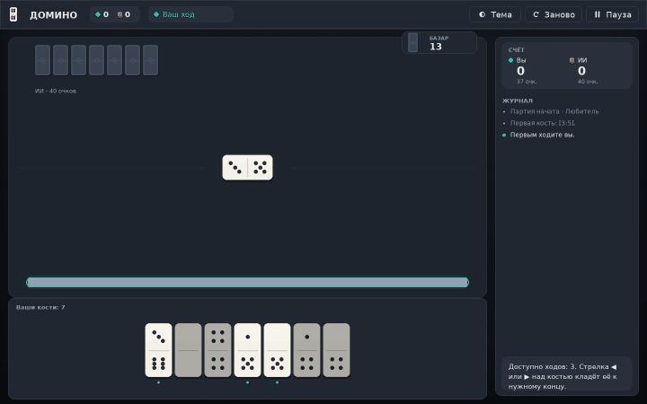
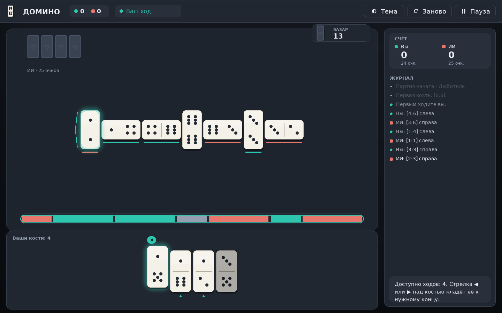

# Домино

Классическое домино против компьютера на Python и pygame-ce.




## Что нового во второй версии

- **Современный интерфейс**: меню, панель счёта, мини-карта цепочки, журнал
  ходов, подсказки, пауза и экран результата.
- **Три темы оформления** — «Графит», «Клуб», «Дерево». Переключаются в меню,
  клавишей `F2` или ключом `--theme`, выбор запоминается.
- **Три уровня ИИ** — «Новичок», «Любитель» и «Мастер» (Monte-Carlo + точный
  решатель эндшпиля).
- **Новые правила** — добор до первой подходящей кости и подсчёт очков при
  обоюдной блокировке.
- Управление мышью, drag&drop и полностью с клавиатуры.



## Установка и запуск

Нужен Python 3.10 или новее. Игра **не пишет ничего за пределы своей папки**:
единственный создаваемый файл — `settings.json` с выбранной темой, сложностью и
первым ходом (лежит рядом с `start.py`). Ни в профиль пользователя, ни во
временные каталоги ничего не сохраняется.

Шрифты лежат в `assets/fonts`, поэтому вид игры одинаковый на Windows, Linux и
macOS — системные шрифты не требуются.

```bash
python3 -m venv venv
source venv/bin/activate        # Windows: venv\Scripts\activate

# если раньше стоял обычный pygame — сначала удалите его
pip uninstall -y pygame
pip install -r requirements.txt

python3 start.py                # или: python3 start.pyw / python3 -m domino
```

На Windows игру можно запускать двойным кликом по `start.pyw` — консольное окно
не появится. Если `.pyw` не связан с Python, используйте `start.py` или
`python start.py` из папки игры.

`requirements.txt` ставит **pygame-ce** — совместимый форк pygame (модуль
по-прежнему называется `pygame`). Минимальная версия — 2.5.8.

### Ключи запуска

```bash
python3 start.py --theme club_green      # тема: flat_dark | club_green | warm_wood
python3 start.py --difficulty hard       # ИИ: easy | medium | hard
python3 start.py --skip-menu             # сразу в игру
python3 start.py --debug                 # счётчик FPS
```

## Управление

| Действие | Мышь | Клавиатура |
| --- | --- | --- |
| Выбрать кость | клик по кости | `↑` / `↓` |
| Положить в цепочку | клик по концу цепочки или стрелке «слева»/«справа» | `Enter` |
| Перетащить кость | зажать и отпустить над концом цепочки | — |
| Взять из базара | клик по панели «Базар» | `B` |
| Прокрутить цепочку | колесо мыши | `←` / `→` |
| Пауза | кнопка в правом верхнем углу | `Esc` |
| Сменить тему | кнопка-палитра | `F2` |
| Новая партия | кнопка-обновление | `R` на экране результата |

## Правила

Используется классический набор из 28 костей, по 7 на руку, 13 в базаре.

- Если подходящей кости нет, игрок **добирает из базара до первой подходящей**
  (или до пустого базара).
- Партия заканчивается, когда кто-то выложил все свои кости.
- Если ходов нет ни у кого и базар пуст (**блокировка**), побеждает тот, у кого
  меньше очков на руках; победитель получает очки соперника.
- Счёт накапливается в текущей сессии.

## Уровни сложности

| Уровень | Как играет |
| --- | --- |
| Новичок | Ошибается примерно в 22% ходов, сбрасывает тяжёлые кости и дубли. |
| Любитель | Считает вероятности: сколько невидимых костей может ответить сопернику, насколько закрывается конец, что останется на руке. В эндшпиле включает точный решатель. |
| Мастер | Monte-Carlo: перебирает правдоподобные расклады руки соперника и доигрывает партию. При пустом базаре решает эндшпиль минимаксом. |

Замеры силы (парные сиды; победа = 1, ничья = 0,5):

| Пара | Партий | Очки |
| --- | --- | --- |
| Новичок против случайного игрока | 2 400 | 55,6% |
| Любитель против случайного игрока | 2 400 | 72,0% |
| Любитель против ИИ первой версии | **9 000** | **53,7%** |
| Мастер против Любителя | 800 | 51,2% |
| Мастер против ИИ первой версии | 1 200 | 55,9% |

Разница на глаз: «Любитель» не отдаёт выигранные концовки, а «Мастер»
дополнительно перебирает раскладку руки соперника.

## Архитектура

```
domino/
  engine.py          чистые правила: GameState, ходы, добор, результат
  settings.py        размеры, правила, бюджеты ИИ
  config.py          сохранение темы и сложности в settings.json рядом с игрой
  ai/
    base.py          интерфейс стратегии
    easy.py          новичок
    medium.py        вероятностная эвристика + короткий PIMC
    hard.py          Monte-Carlo по мирам + решатель эндшпиля
    solver.py        минимакс с альфа-бета отсечением
    knowledge.py     оценка невидимых костей
    rollout.py       доигрывание партии в симуляции
    arena.py         headless-матчи
    legacy.py        ИИ первой версии — только для сравнения
  ui/
    app.py           окно, цикл, стек сцен
    theme.py         три темы
    assets.py        кэш фонов, шрифтов, граней костей
    board.py         цепочка, камера, мини-карта
    hand.py          рука игрока
    sidebar.py       счёт, журнал, подсказки
    scenes.py        меню, игра, пауза, результат
    widgets.py       кнопки, переключатели, панели
assets/fonts/       шрифты DejaVu (одинаковый вид на всех ОС)
settings.json       создаётся при первом выходе: тема, сложность, первый ход
tests/              правила, инварианты, ИИ, дымовые тесты UI
tools/              arena.py, tune.py, search.py, screens.py, docs.py, gif.py, perf.py
```

Движок не зависит от pygame: `GameState` неизменяем, поэтому ИИ может
симулировать тысячи партий и работать в отдельном потоке.

## Разработка

```bash
python3 -m pytest -q -m "not slow"          # быстрые тесты
python3 -m pytest -q                        # плюс замеры силы ИИ
python3 -m tools.arena -n 500               # сила ИИ по уровням
python3 -m tools.tune -n 400                # подбор весов «Любителя»
python3 -m tools.screens -o screenshots/dev # снимки всех сцен и тем
python3 -m tools.perf                       # цена кадра и смены темы
```

Скриншоты и GIF для документации (всё складывается в `screenshots/`):

```bash
python3 -m tools.docs                       # меню, игра, результат во всех темах
python3 -m tools.gif                        # анимированный ход (нужен Pillow)
```
