# Domino
Домино на Python

Игра на pygame. Проект написан с использованием библиотеки pygame. 
Файлы проекта:
- start.pyw. 
  С этого файла начинается выполнение программы. Он содержит основной цикл pygame, а также код, создающий объекты всех основных классов. Функционирование программы построено на     взаимодействии между объектами и изменении ими внутреннего состояния друг друга.
- classes.py. Файл со всеми классами игры
- utils.py. Файл с общими разделяемыми функциями и функциями отрисовки слоёв.
- settings.py. Файл с настройками (настройки цветов, размеров и положений объектов т.п.)

Классы в модуле classes:
- Domino. Служит для представления и отображения отдельных домино.
- Chain. Служит для хренения и отображения цепочки домино. Домино в цепочке поставленные игроком и компьютером различаются по цвету (зеленый - игрок, красный - компьютер).
- Scope. Служит для вывода на экран текущего видимого участка цепочки.
- EdgePane. Служит для отображения панелей с домино на концах цепочки. Вся цепочка домино может не помещаться на экране и чтоб можно было быстро посмотреть, какие домино сейчас находятся на невидимых концах и предусмотрен данный класс. Экземпляр данного класса отслеживает цепочку и выводит невидимые домино по краям, чтобы игроку не пришлось      постоянно скроллить колесиком мыши или кнопками со стралками (влево и вправо). Также можно кликать на сами панели для быстрой прокрутки цепочки влево или вправо.
- Storage. Хранилище домино - база, из которой могут брать домино игрок и компьютер.
- PLayerPool. Домино игрока.
- CmpPool. Домино компьютера.
- Logger. Выводит список последних действий игрока и компьютера.
- Ai. Отвечает за выбор хода компьютера.

Так как домино - это игра, в которой нет полной информации о возможных действиях другого игрока (в отличие, например, от шахмат, в которых позиции всех фигур на доске видны обоим игрокам), то для расчета очередного хода невозможно применить распространенный в шахматах/шашках и им подобных играх алгоритм минимакс (альфа/бета отсечение). И для оценки очередного хода приходится применять определенный набор эвристических правил.
Я применил три таких правила:
1) Надо стремиться избавляться от дублей. Ход дублем тем ценнее, чем больше домино с его мастью уже вышло из игры.
2) Надо стремиться ставить в цепочку домино с такими мастями, чтобы вероятность их нахождения у игрока на руках была минимальной. Например, у нас есть цепочка, которая оканчивается на 5 и 2. И три домино в пуле - 2:3, 5:3 и 2:6. Мы видим, что тройки уже все вышли и все оставшиеся тройки находятся у нас на руках. Тогда можно пойти 5:3 и заблокировать игроку одну сторону цепочки, оставив её открытой для себя.
3) Нужно отслеживать состояние цепочки в тот момент, когда игрок берет домино из кучи. Те масти, которые находятся в этот момент на концах цепочки - отсутствуют у игрока. И нужно стремиться снова выставить их на концы цепочки, чтобы игрок пропускал ход или вновь добирал домино из кучи.


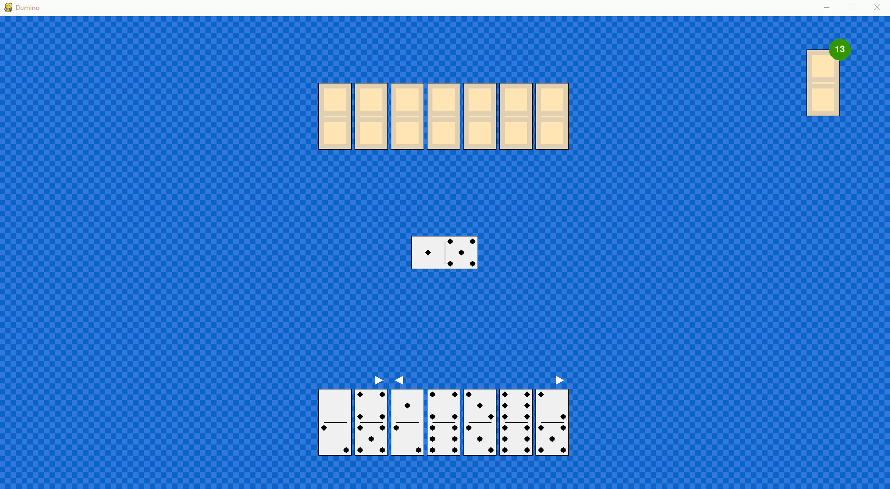

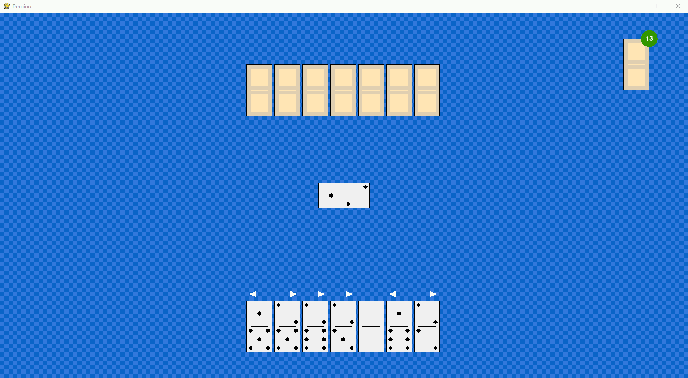

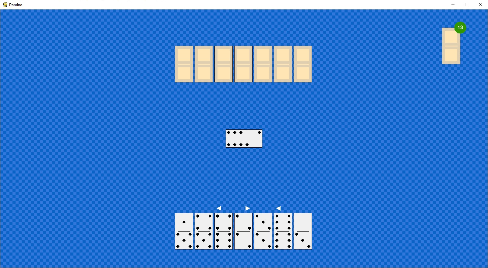

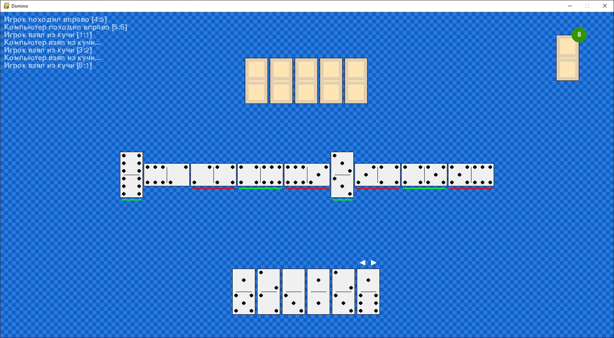

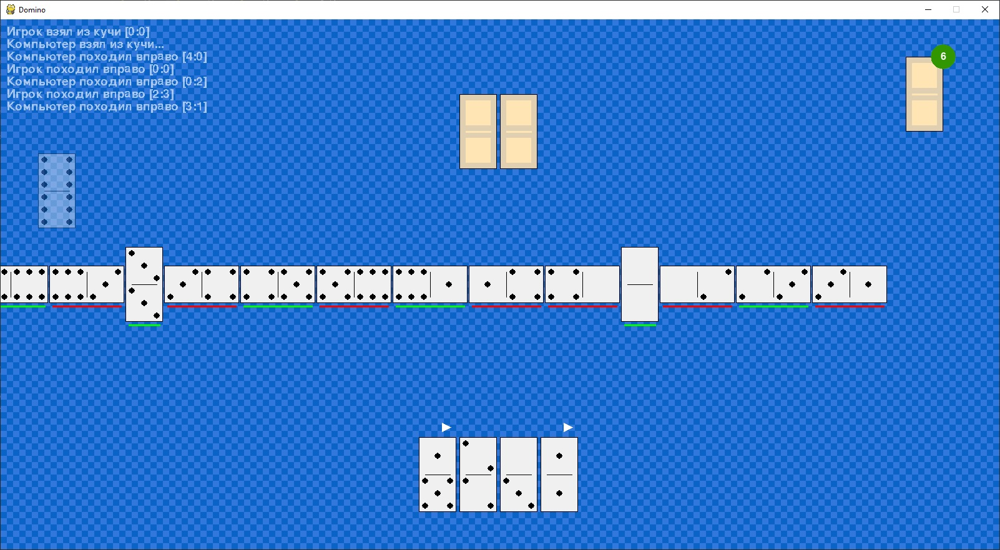

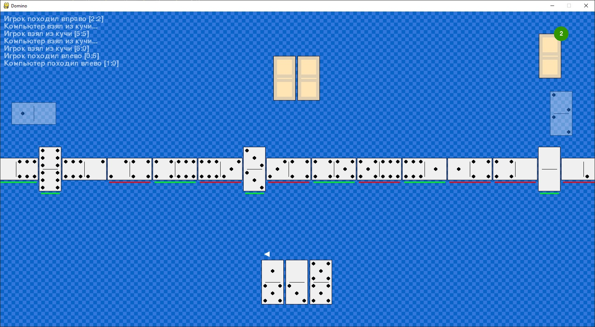

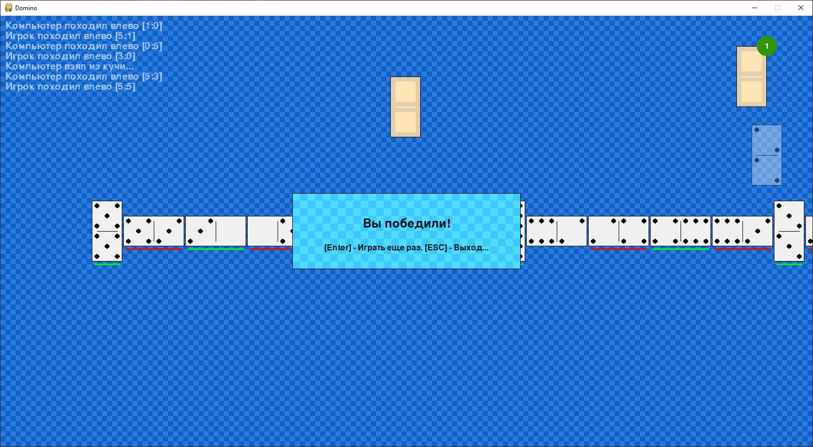

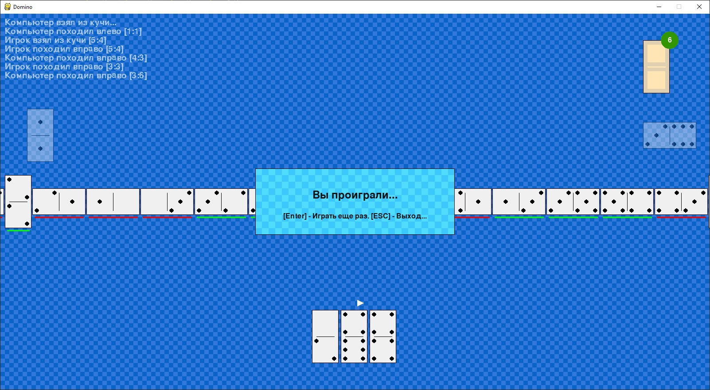

---

# Обновление — ноябрь 2026

Игра переписана заново. Правила и дух остались прежними, но движок, интерфейс
и ИИ сделаны с нуля. Ниже — что изменилось и как игра выглядит теперь.

## Было / стало

| Первая версия | Ноябрь 2026 |
| --- | --- |
|  |  |

| Экран результата раньше | Сейчас |
| --- | --- |
|  | 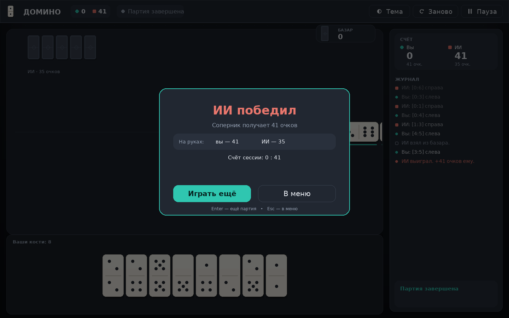 |

Старая версия была одним окном с синим фоном и текстовым списком ходов.
Теперь есть меню, панель счёта, журнал, подсказки, пауза и экран результата.

## Что добавили

- **Современный интерфейс**: меню выбора сложности, темы и первого хода,
  панель счёта, журнал партии, подсказки концов, пауза, экран результата.
- **Пять тем стола** — три тёмные («Графит», «Клуб», «Дерево») и две светлые
  («Лён», «Небо»). Переключаются в меню, клавишей `F2` или ключом `--theme`;
  выбор запоминается.
- **Три набора костей** — «Кость», «Оникс», «Янтарь», независимо от темы
  стола. Переключаются в меню, клавишей `F3`, кнопкой в верхней панели или
  ключом `--tiles`. Если кость сливается с полем (светлая на светлом, тёмная
  на тёмном), включается контрастная обводка.
- **Три уровня ИИ** — «Новичок», «Любитель» и «Мастер».
- **Новые правила** — добор до первой подходящей кости и подсчёт очков при
  обоюдной блокировке.
- **Управление мышью**: выбор кости, drag&drop, клик по концу цепочки.
  Всё доступно и с клавиатуры.
- **Кроссплатформенность**: Windows, Linux и macOS. Шрифты лежат в самой игре,
  поэтому вид одинаковый везде и не зависит от системных шрифтов.
- **Игра не пишет ничего за пределы своей папки** — только `settings.json`
  рядом с `start.py`.

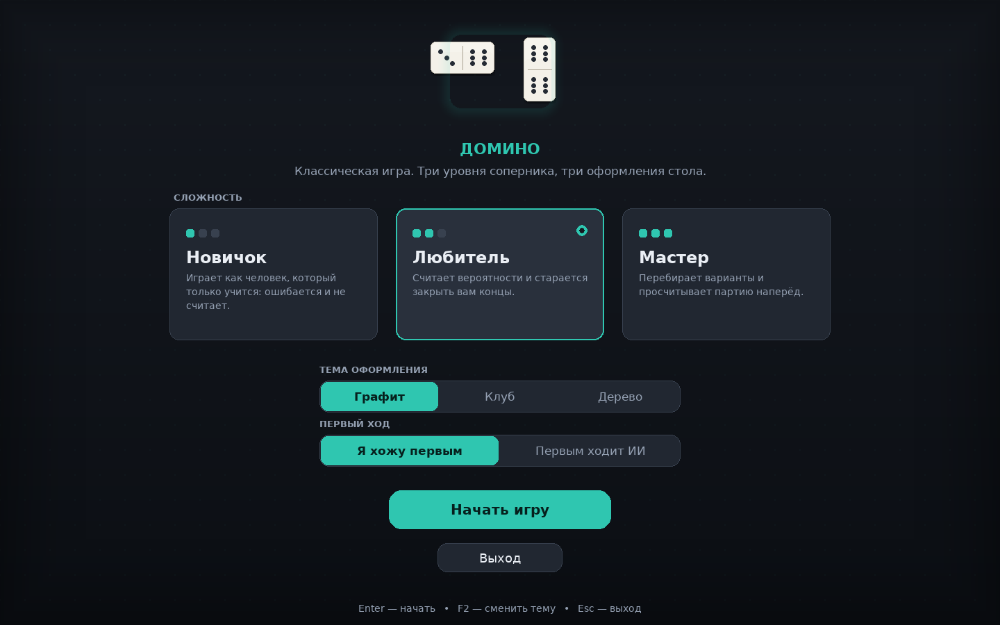


## Темы стола


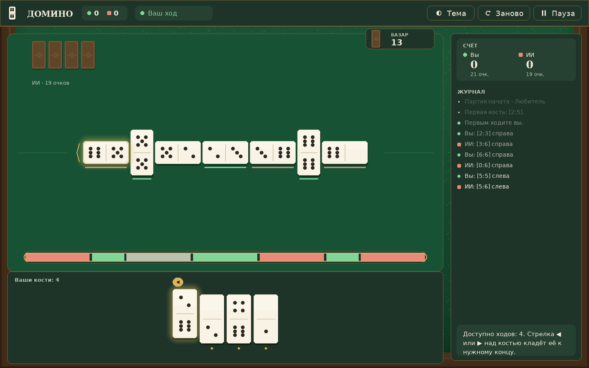

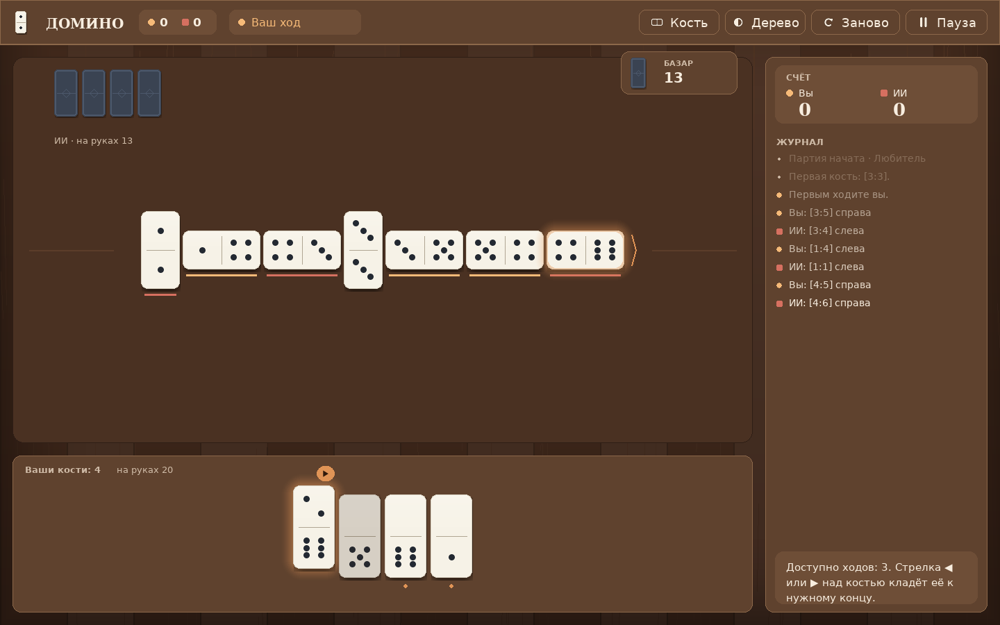

Светлые темы:

| Лён | Небо |
| --- | --- |
| 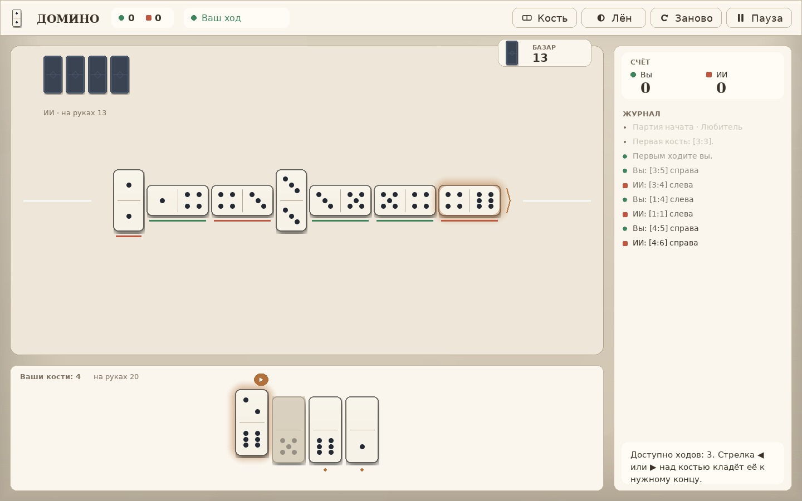 | 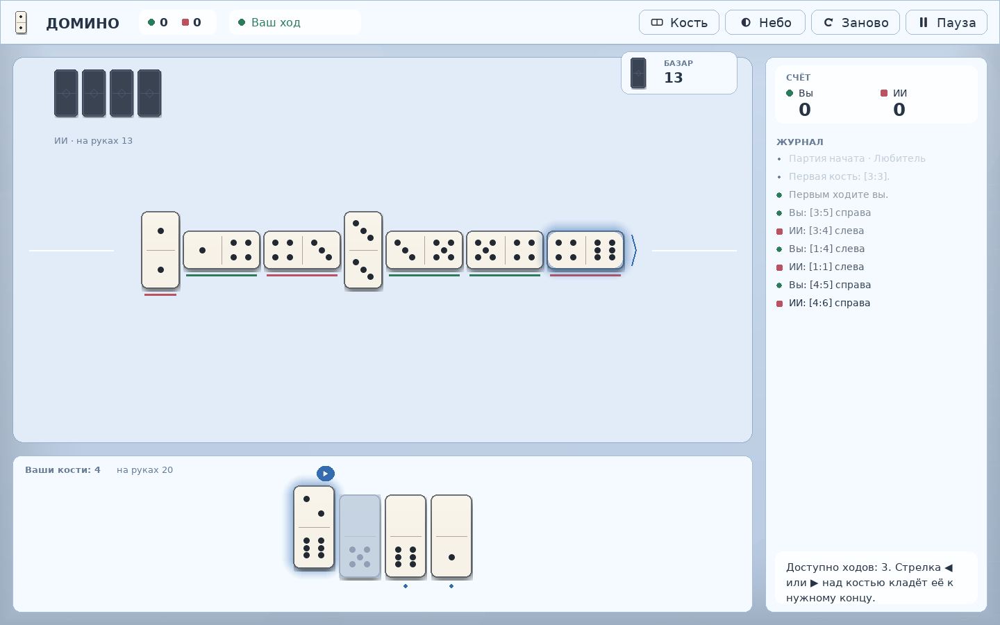 |

## Наборы костей

Кости не привязаны к теме стола — набор выбирается отдельно:

| Кость | Оникс | Янтарь |
| --- | --- | --- |
|  | 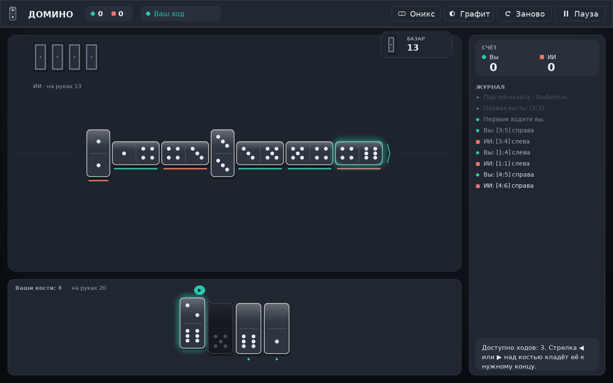 | 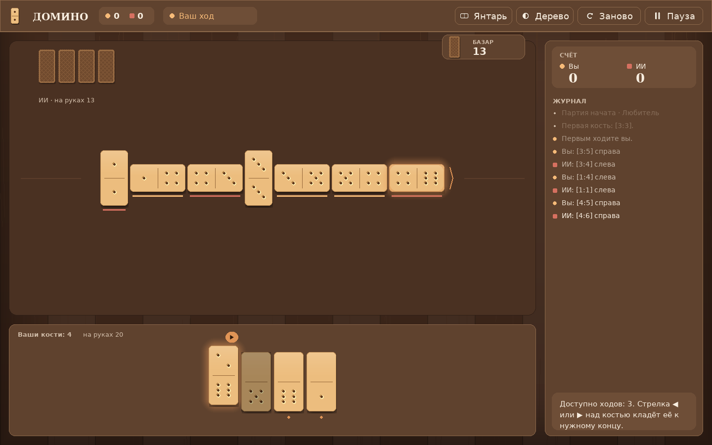 |

## Установка и запуск

Нужен Python 3.10 или новее. Единственный создаваемый файл — `settings.json`
с выбранной темой стола, набором костей, сложностью и первым ходом (лежит
рядом с `start.py`). Ни в профиль пользователя, ни во временные каталоги
ничего не сохраняется.

```bash
python3 -m venv venv
source venv/bin/activate        # Windows: venv\Scripts\activate

# если раньше стоял обычный pygame — сначала удалите его
pip uninstall -y pygame
pip install -r requirements.txt

python3 start.py                # или: python3 start.pyw / python3 -m domino
```

На Windows игру можно запускать двойным кликом по `start.pyw` — консольное
окно не появится. Если `.pyw` не связан с Python, используйте `start.py` или
`python start.py` из папки игры.

`requirements.txt` ставит **pygame-ce** — совместимый форк pygame (модуль
по-прежнему называется `pygame`). Минимальная версия — 2.5.8.

### Ключи запуска

```bash
python3 start.py --theme club_green      # flat_dark | club_green | warm_wood | linen | sky
python3 start.py --tiles graphite        # bone | graphite | amber
python3 start.py --difficulty hard       # easy | medium | hard
python3 start.py --skip-menu             # сразу в игру
python3 start.py --debug                 # счётчик FPS
```

## Управление

| Действие | Мышь | Клавиатура |
| --- | --- | --- |
| Выбрать кость | навести или кликнуть по кости | `↑` / `↓` |
| Положить в цепочку | стрелка `◀`/`▶` над костью, клик по концу цепочки | `Enter` |
| Перетащить кость | зажать и отпустить над концом цепочки | — |
| Взять из базара | клик по панели «Базар» | `B` |
| Прокрутить цепочку | колесо мыши | `←` / `→` |
| Пауза | кнопка в правом верхнем углу | `Esc` |
| Сменить тему | кнопка-палитра | `F2` |
| Сменить кости | кнопка с костяшкой | `F3` |
| Новая партия | кнопка-обновление | `R` на экране результата |

При наведении на кость над ней появляются подсказки концов: `◀` кладёт её к
левому концу цепочки, `▶` — к правому. Стрелки не перекрывают соседние кости и
работают как обычные кнопки.

## Правила

Используется классический набор из 28 костей, по 7 на руку, 13 в базаре.

- Если подходящей кости нет, игрок **добирает из базара до первой подходящей**
  (или до пустого базара).
- Партия заканчивается, когда кто-то выложил все свои кости.
- Если ходов нет ни у кого и базар пуст (**блокировка**), побеждает тот, у кого
  меньше очков на руках; победитель получает очки соперника.
- Счёт накапливается в текущей сессии.

## Уровни сложности

| Уровень | Как играет |
| --- | --- |
| Новичок | Ошибается примерно в 22% ходов, сбрасывает тяжёлые кости и дубли. |
| Любитель | Считает вероятности: сколько невидимых костей может ответить сопернику, насколько закрывается конец, что останется на руке. В эндшпиле включает точный решатель. |
| Мастер | Monte-Carlo: перебирает правдоподобные расклады руки соперника и доигрывает партию. При пустом базаре решает эндшпиль минимаксом. |

Замеры силы (парные сиды; победа = 1, ничья = 0,5):

| Пара | Партий | Очки |
| --- | --- | --- |
| Новичок против случайного игрока | 2 400 | 55,6% |
| Любитель против случайного игрока | 2 400 | 72,0% |
| Любитель против ИИ первой версии | **9 000** | **53,7%** |
| Мастер против Любителя | 800 | 51,2% |
| Мастер против ИИ первой версии | 1 200 | 55,9% |

Разница на глаз: «Любитель» не отдаёт выигранные концовки, а «Мастер»
дополнительно перебирает раскладку руки соперника.

## Архитектура

Старые `classes.py` и `utils.py` разобраны на модули: правила отдельно от
отрисовки, ИИ отдельно от правил.

```
domino/
  engine.py          чистые правила: GameState, ходы, добор, результат
  settings.py        размеры, правила, бюджеты ИИ
  config.py          сохранение темы и сложности в settings.json рядом с игрой
  ai/
    base.py          интерфейс стратегии
    easy.py          новичок
    medium.py        вероятностная эвристика + короткий PIMC
    hard.py          Monte-Carlo по мирам + решатель эндшпиля
    solver.py        минимакс с альфа-бета отсечением
    knowledge.py     оценка невидимых костей
    rollout.py       доигрывание партии в симуляции
    arena.py         headless-матчи
    legacy.py        ИИ первой версии — только для сравнения
  ui/
    app.py           окно, цикл, стек сцен
    theme.py         пять тем стола
    tiles.py         три набора оформления костей
    assets.py        кэш фонов, шрифтов, граней костей
    board.py         цепочка костей и камера
    hand.py          рука игрока
    sidebar.py       счёт, журнал, подсказки
    scenes.py        меню, игра, пауза, результат
    widgets.py       кнопки, переключатели, панели
assets/fonts/       шрифты DejaVu (одинаковый вид на всех ОС)
settings.json       создаётся при первом выходе: тема, кости, сложность, первый ход
tests/              413 тестов: правила, инварианты, ИИ, интерфейс
tools/              arena.py, tune.py, search.py, screens.py, docs.py, gif.py, perf.py
```

Движок не зависит от pygame: `GameState` неизменяем, поэтому ИИ может
симулировать тысячи партий и работать в отдельном потоке.

## Разработка

```bash
python3 -m pytest -q -m "not slow"          # быстрые тесты
python3 -m pytest -q                        # плюс замеры силы ИИ
python3 -m tools.arena -n 500               # сила ИИ по уровням
python3 -m tools.tune -n 400                # подбор весов «Любителя»
python3 -m tools.screens -o screenshots/dev # снимки всех сцен, тем и наборов костей
python3 -m tools.perf                       # цена кадра и смены темы
```

Скриншоты и GIF для документации (всё складывается в `screenshots/`):

```bash
python3 -m tools.docs                       # меню, игра, результат во всех темах и наборах
python3 -m tools.gif                        # анимированный ход (нужен Pillow)
```
